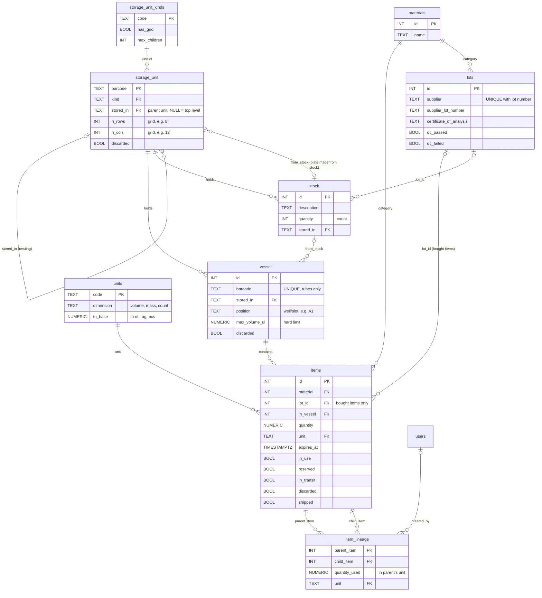
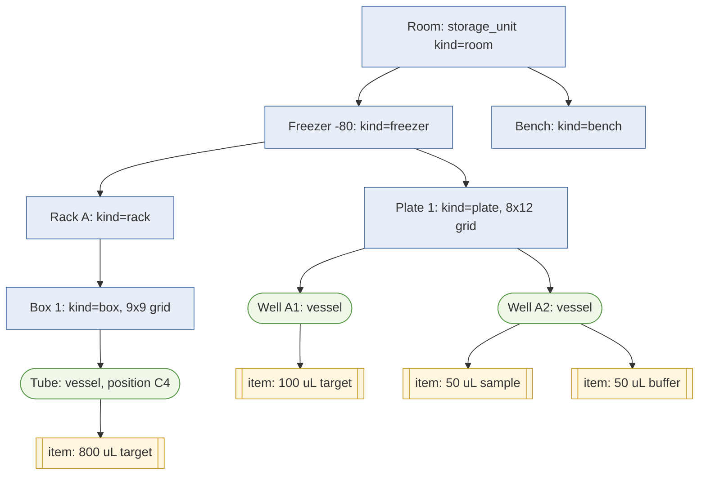
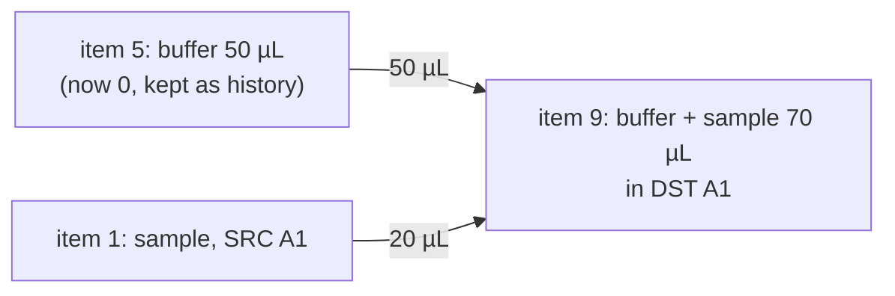
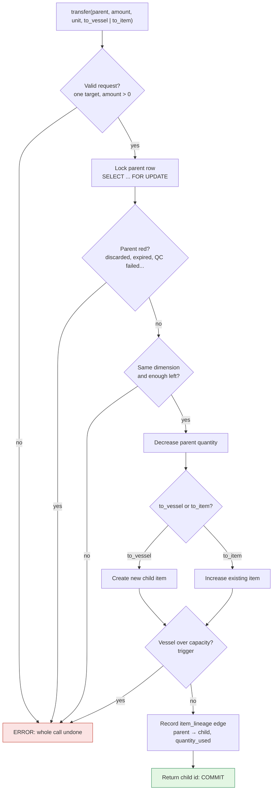
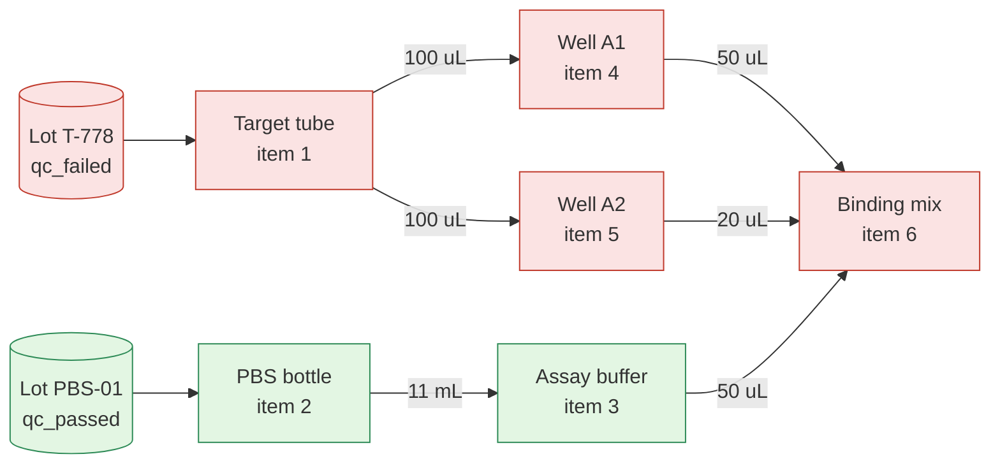
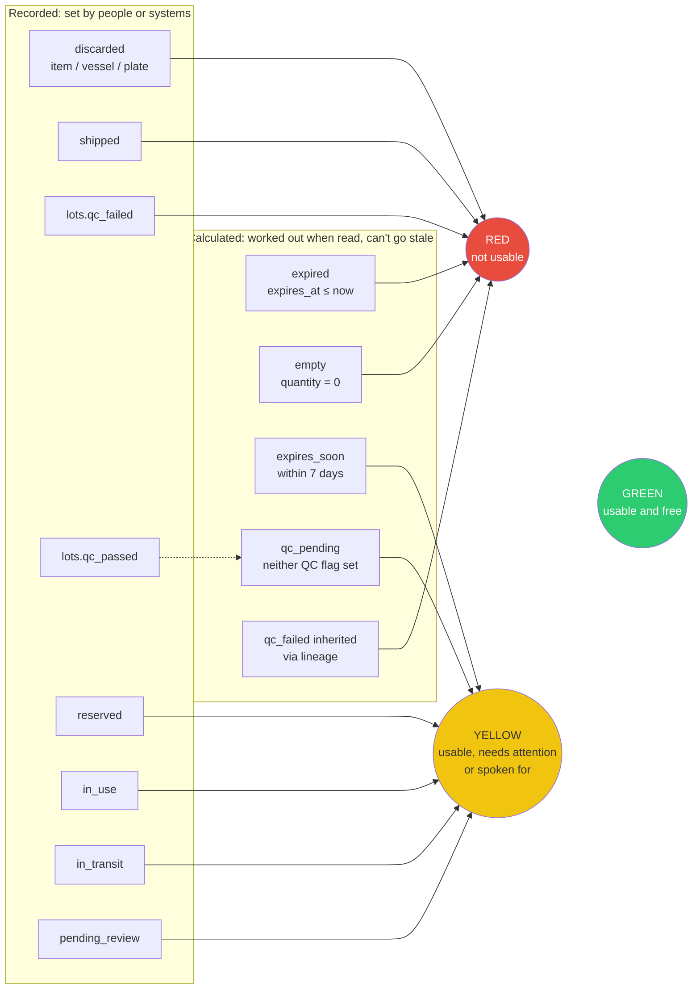
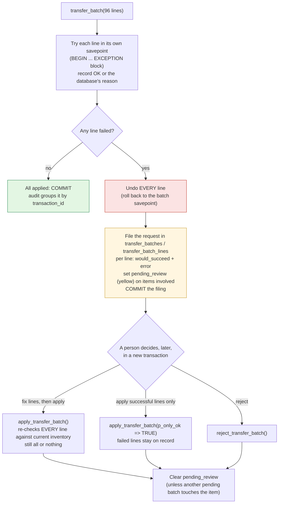
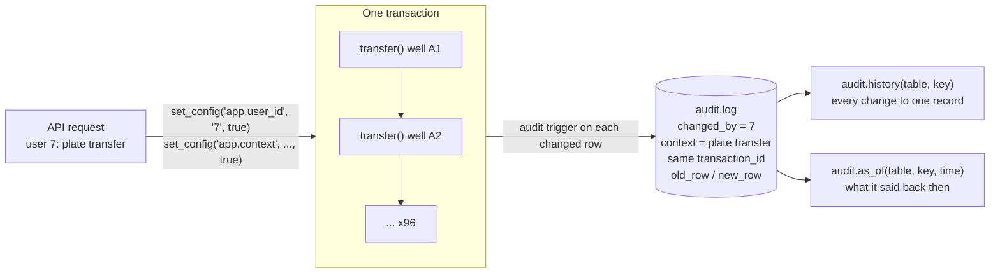

# Lab Inventory: Data Model

This is a PostgreSQL data model for tracking lab material. It records what the lab has, how much of it is usable, where it is, what it was made from, and what was made from it.

The main design rule is that **the database enforces correctness itself**. Quantities, capacity and usability are either enforced by constraints and triggers, or calculated from facts when they're read. They're never kept up to date by hand, so they can't drift. Other systems, such as experiment planning or a future API, can rely on the numbers.

```text
initdb/
  01-schema.sql           tables and constraints
  02-reference-data.sql   lookup rows: material categories, units, storage kinds
  03-functions.sql        views, functions and triggers (the behaviour)
  04-audit.sql            audit log: who changed what, when, and what it said before
notes.md                  design notes, traffic-light reference, known gaps
API_PLAN.md               draft plan for the FastAPI layer
```

## Running it

```sh
docker compose up -d
# apply the schema (initdb/ is not mounted into the container, so this is a manual step)
cat initdb/*.sql | docker compose exec -T postgres psql -U app -d app -v ON_ERROR_STOP=1
docker compose exec postgres psql -U app -d app     # SQL shell
```

To try it without keeping anything, wrap it in a transaction that gets rolled back:
`{ echo 'BEGIN;'; cat initdb/*.sql; echo 'ROLLBACK;'; } | docker compose exec -T postgres psql -U app -d app`

---

## 1. The model at a glance



The model is built from four ideas:

| Concept | Table | In one sentence |
|---|---|---|
| **Where** | `storage_unit` | Rooms, freezers, racks, boxes and plates, nested to any depth through one parent pointer. |
| **In what** | `vessel` | One container of liquid: a tube, or one well of a plate. |
| **What and how much** | `items` | A physical amount of one material in one vessel, with a quantity and a unit. |
| **From what** | `item_lineage`, `lots` | Every item made from other items records its parents. Bought items record their supplier lot. |

`stock` holds countable consumables (tips, empty plates, chips). `units`, `storage_unit_kinds` and `materials` are lookup tables, so a new unit, storage kind or material category is a **new row, not a schema change**.

---

## 2. Storage locations, and things that move between them



- **Nesting uses a parent pointer.** `storage_unit.stored_in` references another storage unit, and NULL means a top-level place. An earlier draft also kept a list of children in an array column. That was removed, because Postgres can't enforce foreign keys on array elements, and two copies of the same relationship eventually disagree.
- **Moving something is one update.** Moving a rack to another freezer changes only the rack's `stored_in`. Everything inside it moves with it, because their own links don't change.
- **A plate is a storage unit, and each well is a vessel.** The brief says each well holds its own material. The plate's `n_rows`/`n_cols` describe its grid, and each well's `position` says where it sits. `UNIQUE (stored_in, position)` stops two vessels claiming the same well.
- **`storage_unit_kinds` says how each kind fills up.** A plate has fixed slots (`has_grid`), a rack has a count limit (`max_children`), and a room has no limit. Benches and instruments are just storage kinds, so "inside the plate reader" works like any other location.
- **`storage_unit_contents(barcode)`** returns everything inside a unit at any depth. It uses a recursive query with a `CYCLE` guard, so a mis-scan that creates a loop (A inside B inside A) can't make it run forever.

## 3. Quantities and capacity

- **Every item has `quantity` + `unit`.** `units` maps each unit to a dimension and a conversion factor (1 mL → 1000 µL), so different units can be added together and converted safely.
- **A vessel's fill level is calculated, never stored.** The `vessel_fill` view adds up the vessel's items, so it can't get out of step with them.
- **`max_volume_ul` is a hard limit**, enforced by a trigger on `items`. Overfilling a well raises an error and the whole operation is undone.
- **Duplicate deliveries are rejected:** `UNIQUE (supplier, supplier_lot_number)` stops the same lot being registered twice.

## 4. Consumption: `transfer()`

All material movement goes through one function. It takes an amount out of a parent item and puts it either into a **vessel** (aliquots, dilution copies, robot well-to-well transfers) or into an **existing item** (adding a component to a buffer being made).

**One liquid per vessel.** Once two liquids are in the same well, they physically *are* one liquid. So a vessel holds at most one item with quantity > 0, enforced by a partial unique index (`UNIQUE (in_vessel) WHERE quantity > 0`). Transferring into a vessel that already has content empties the existing item into a **new mixture item**, which records both inputs as parents:



- **A mixture is just an item with several parents.** There's no separate concoctions table: tracing, status and quantity all work the same way.
- **Its material** defaults to that of the material being added, and can be overridden with `p_material`.
- **It expires** at the earliest expiry of its inputs.
- **A new item, not a grown one.** The old item keeps a true record ("this was 50 µL of buffer"), and the lineage records exactly how much of each input went in.



- **All or nothing.** A function call is a single statement, so if any step fails, every earlier step is undone. A failed transfer can't leave the parent decreased with no child created.
- **The lock stops double-spending.** A second transfer from the same tube waits until the first one finishes, so two people can't both take the last 100 µL.
- **Yellow material can still be transferred.** QC itself uses material from a lot whose QC is pending.

```sql
SELECT inventory.transfer(1, 100, 'uL', p_to_vessel => 7);  -- aliquot 100 µL of item 1 into vessel 7
SELECT inventory.transfer(4, 2,   'mL', p_to_item   => 12); -- add 2 mL of item 4 into mixture 12
```

## 5. Lineage: where did it come from, and where did it go?



Lineage is a **graph, not a tree**. A mixture has several parents, so the same item can be reached by more than one route: above, the binding mix is reached from the target through both A1 and A2. Each tracing function returns every item **once**, at its shortest distance.

| Function | Answers |
|---|---|
| `lot_trace(lot_id)` | "This target batch is bad. What did it touch?" Returns the lot's items and everything made from them. |
| `item_descendants(item_id)` | Everything made from this item, at any depth |
| `item_ancestors(item_id)` | Everything this item was made from, at any depth |

**Bought items** record their supplier lot in `lot_id`. **Made items** leave it empty and are traced back to lots through `item_lineage`, because a made item can have parents from several different lots.

## 6. Usable vs merely exists: the traffic light

Every state is an **independent boolean**. The colour is **calculated** in the `item_status` view: the most severe active flag wins, and the view also lists *why* in `red_reasons` and `yellow_reasons`.



- **Recorded or calculated?** Facts that people *record* are stored. Facts that *follow from other data* (expired, empty, QC inherited through lineage) are calculated each time they're read. A stored "expired" flag would need a job to flip it at midnight, and one missed run would make the data wrong.
- **Each flag lives on the object it describes.** QC belongs to the **lot**, so failing a lot later turns **everything made from it red, at any depth**, without updating a single item. Discarding belongs to the **container**, so throwing a plate away turns all its wells red.
- **Contradictory combinations are blocked** by `CHECK` constraints: a lot can't be both `qc_passed` and `qc_failed`, and an item can't be both `discarded` and `shipped`.
- **Adding a state** means adding a boolean, then adding one line to `red_reasons` or `yellow_reasons`. The colour updates automatically.
- **`material_quantities`** gives totals per material category and colour. That answers the brief's question "how much do we have, and how much of it is usable?"

---

## 7. Lab-sized actions: batches and failed runs

A robot copying a 96-well plate is one action, but the database's unit of work is one well. `transfer_batch(lines)` runs many transfers as **one all-or-nothing action**. If a line fails, the run isn't lost: it's **filed for a person to decide on**.



- **All or nothing:** the inventory never records a half-done plate.
- **Every line is checked, not just the first failure.** Each line runs in its own savepoint, so the reviewer sees *all* the problems at once: "line 2: Item 4 has only 100 µL, cannot take 500 µL" and "line 3: Item 9999 does not exist".
- **The filed lines store the raw request, with no foreign keys.** A line may have failed precisely because it pointed at something that doesn't exist (a wrong scan), and it must still be filed.
- **Applying re-checks everything,** because "would have succeeded" goes stale: someone may have used the material since.
- **No database write waits on a person.** The filing commits immediately, and the decision is a separate transaction.
- **Accepted trade-off:** while a batch is pending, the database may not match the bench, because the robot may already have run. The yellow `pending_review` flag makes that visible to planning instead of hiding it.

## 8. Who changed what: the audit log

Every insert, update and delete on the data and reference tables is recorded in `audit.log` by one generic trigger. Each entry holds the **full old and new row** as JSONB, plus who made the change, why, and which action it belonged to.



| Column | Answers |
|---|---|
| `changed_by` | **Who.** Read from the transaction-local setting `app.user_id`, which the API sets for each request. |
| `db_role` | Who *connected*. It catches changes made outside the API, for example in psql, where `changed_by` is empty. |
| `context` | **Why.** For example "plate transfer PLATE-1 → PLATE-2". |
| `transaction_id` | **Which action.** All 96 well changes from one plate action share it, so a bulk action can be reviewed or traced as one unit. |
| `changed_columns` | **What** changed. An update that changes nothing isn't logged. |
| `old_row` / `new_row` | **What it said before**, and after. |

- **One trigger for every table.** The primary key is passed to the trigger as an argument, because the tables use different keys (`id`, `barcode`, `code`, or `parent_item,child_item` for lineage).
- **Append-only.** Updating, deleting or truncating `audit.log` is rejected. The trigger function is `SECURITY DEFINER`, so the API's database role can *cause* audit rows to be written without being able to write, edit or delete them itself.
- **`users` is not audited by this trigger,** because its rows contain `password_hash`, which shouldn't be copied into a widely readable log.
- **`transfer()` fills in `item_lineage.created_by`** from the same `app.user_id` setting, so the API doesn't have to pass the user separately.

```sql
SELECT * FROM audit.history('inventory.items', '3');                        -- every change to item 3
SELECT audit.as_of('inventory.items', '3', '2026-11-25 14:00+00');          -- item 3 as it was then
SELECT * FROM audit.log WHERE transaction_id = 81234;                       -- everything one action did
```

## 9. How the brief's questions are answered

| # | Question | Answered by |
|---|---|---|
| 1 | How much do we have, and how much is usable? | `material_quantities` view; `item_status.light` per item |
| 2 | Is it still viable? What expires soon? | `item_status` flags `expired` and `expires_soon` |
| 3 | Where is it? | `items.in_vessel` → `vessel.stored_in` → `storage_unit.stored_in` chain; `storage_unit_contents()` |
| 4 | Where did it come from and where did it go? | `lot_trace()`, `item_ancestors()`, `item_descendants()` |
| 5 | Who changed what, and when? What did it say before? | `audit.log`, `audit.history()`, `audit.as_of()` |

## 10. Assumptions

- **Experiment planning is a separate system.** It *sets* `reserved`, and the inventory only stores it.
- **QC applies per supplier lot.** A lot is pending until one of `qc_passed`/`qc_failed` is set. Material made in-house has no lot, so it has no QC state.
- **Aliquots inherit the parent's `expires_at`.**
- **Capacity is only enforced for volume.** Mass and count items in a vessel don't count towards its fill.
- **Wells are evenly mixed.** A mixture is treated as one uniform liquid. Settled material or beads would need a different model.
- **Moving material between different dimensions is rejected.** `transfer()` won't add µg of DNA into a µL buffer, because concentration isn't modelled.
- **Lab scale:** the tracing and status views recurse through lineage for each item. That's fine for thousands of items. At much larger scale you'd cache the results.

## 11. What was cut, and why

Depth on consumption, lineage and usability was prioritised over breadth.

| Cut | Why, and what it would take |
|---|---|
| **One barcode namespace** | Tubes (`vessel.barcode`) and storage units have barcodes in separate tables. Nothing stops the same barcode being used in both, which would make a scan ambiguous. It needs a shared barcode registry table, or a check across both tables. |
| **Audit retention and storage** | Full-row JSONB on every change grows quickly with robot runs. It would need table partitioning by month, plus an archiving policy. |
| **Expiry that depends on storage conditions** | The brief says lifetime depends on storage and timing. It needs a storage temperature per kind, plus shelf-life rules per material and condition. Today `expires_at` is set directly. |
| **Expires-soon window per material** | It's a fixed 7 days. Loading buffer only lasts 1 week in total, so it would show yellow from the day it's made. |
| **Material-definition layer** | `materials` holds categories (DNA, Target proteins…). A real system needs "target protein PD-L1" between the category and the lot. |
| **Enforcing storage-kind capacity** | `has_grid`/`max_children` describe the rules, but no trigger enforces them yet. Grid positions aren't checked against the grid size either. |
| **Full location path function** | Walking *up* the tree ("Room > Freezer > Rack > Box"). It's the mirror of `storage_unit_contents`. |
| **Edge cases accepted** | Lowering a vessel's `max_volume_ul` isn't checked. Discarding only looks one level up (vessel → its plate). Locking is per item, so two concurrent inserts into the same well could each pass the capacity check. |
