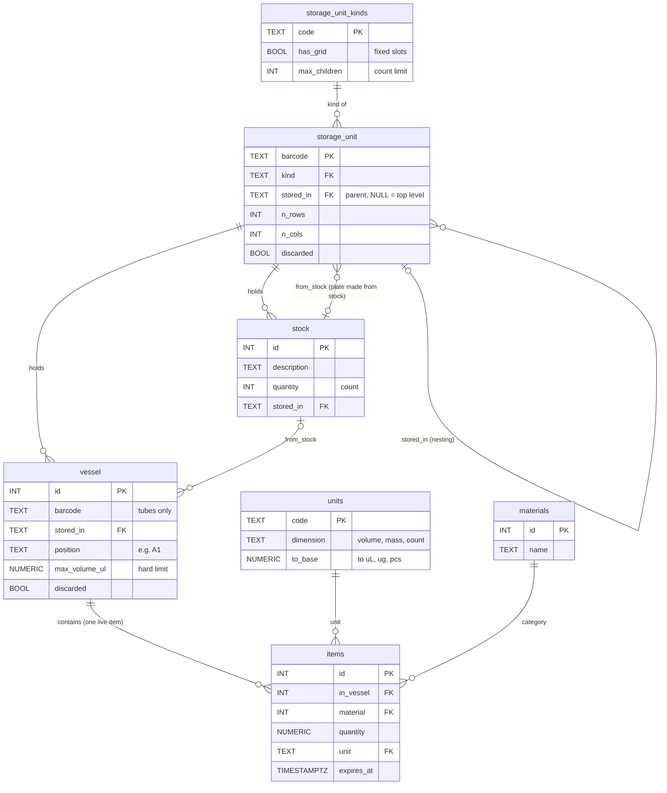
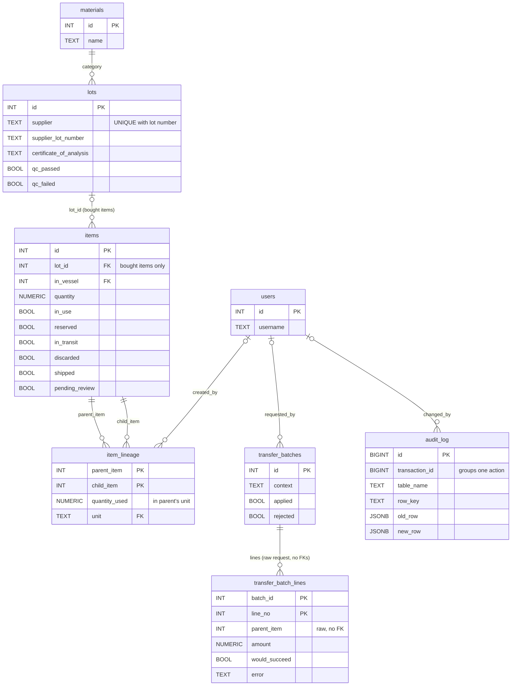

# Slide diagrams

These are extra diagrams for the presentation only. `docs/render-diagrams.sh` renders them after the README's diagrams.

The full ER diagram in the README is too tall for one slide, so it's split here into two halves. The core tables (`storage_unit`, `vessel`, `items`) appear in both halves so each slide stands on its own.

## Location and quantity: where things are, and how much

## Tracing and control: where it came from, who changed it, what's usable

